# DST · Dune Server Tool

**Manage your Dune: Awakening Self-Hosted server or local Solo save from one Windows app.**

By **Coastal** · Discord **@allcoast**

[](https://github.com/coastal-ms/DST-DuneServerTool/releases/latest) [](https://github.com/coastal-ms/DST-DuneServerTool/actions/workflows/lint.yml) [](LICENSE)

### [Download DST](https://github.com/coastal-ms/DST-DuneServerTool/releases/latest/download/DuneServerSetup.exe) · [Install guide](https://duneservertool.com/install) · [Join Discord](https://discord.gg/tj2x7cywSC)

[Features](#what-you-can-do) · [Screenshots](#take-a-look) · [Remote access](#remote-access-and-player-portal) · [Live Maps](#live-maps) · [Help](#help-and-updates) · [Build from source](#build-from-source)

---

## Get started

1. Download and run **DuneServerSetup.exe** from the [latest release](https://github.com/coastal-ms/DST-DuneServerTool/releases/latest).
2. Choose **Solo only** or **Self-Hosted + Solo** during installation.
3. Launch **Dune Server** from the Start Menu and connect your save or set up your server.

| Choose | What you need |
| --- | --- |
| **Solo only** | A supported local Retail Solo save. No VM or server setup required. |
| **Self-Hosted + Solo** | Funcom's Self-Hosted Server package, a local or reachable LAN Hyper-V host, and the VM SSH key. Solo tools are included. |

Both options use the same Solo tools. Updates preserve your installation choice and existing configuration.

**Windows requirements:** Windows 10 or 11, PowerShell 7 and Microsoft Edge WebView2 Runtime. Follow the [install guide](https://duneservertool.com/install) for prerequisites and setup.

## What you can do

| Area | Tools |
| --- | --- |
| **Server operations** | Monitor the VM, battlegroup, maps, ports and memory. Start, stop, restart, update and diagnose your server. |
| **Players and inventory** | Find players, manage progression, inspect inventory and storage, adjust currencies, grant items and appearances, and repair equipment. |
| **World and economy** | Manage bases, vehicles, blueprints, Landsraad and the Exchange. Run the Market Bot with formula or market-follow pricing. |
| **Configuration** | Edit server and local-client settings with typed controls, backups and visible action requirements. |
| **Backups and data** | Create and restore backups, set schedules, import data, run SQL and use migration tools. |
| **Maps** | View live observations and recorded storm trails, or browse the static Deep Desert reference atlas. |
| **Solo saves** | Manage settings, backups, items, vehicle kits, cosmetics, currencies, augments, skills and Journey progression. |

Browse the [website and feature tour](https://duneservertool.com/) for more.

## Take a look

Classic is the default interface. **Try Command Deck** opens an optional task-focused layout with a dashboard, searchable tools and an illustrated Arrakis globe. Both layouts use the same guarded tools. Themes and custom colors are available through **Settings → Appearance**.

Expand a section to view its screenshot. Images use offline states, static atlas data or fictional sample players. The globe organizes reported locations; it is illustrative artwork rather than live game geography.

<details>
<summary><strong>Command Deck (opt-in)</strong></summary>

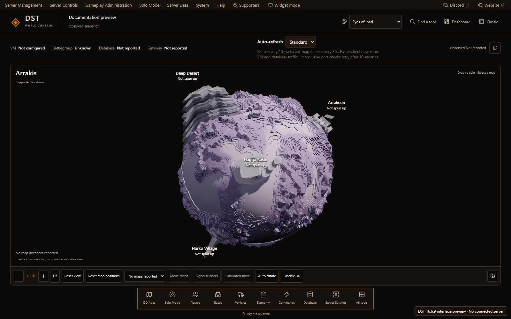

Optional World/dashboard navigation and focused workspaces. The globe organizes
reported status; it is not live game geography.
</details>

<details>
<summary><strong>Server Health</strong></summary>

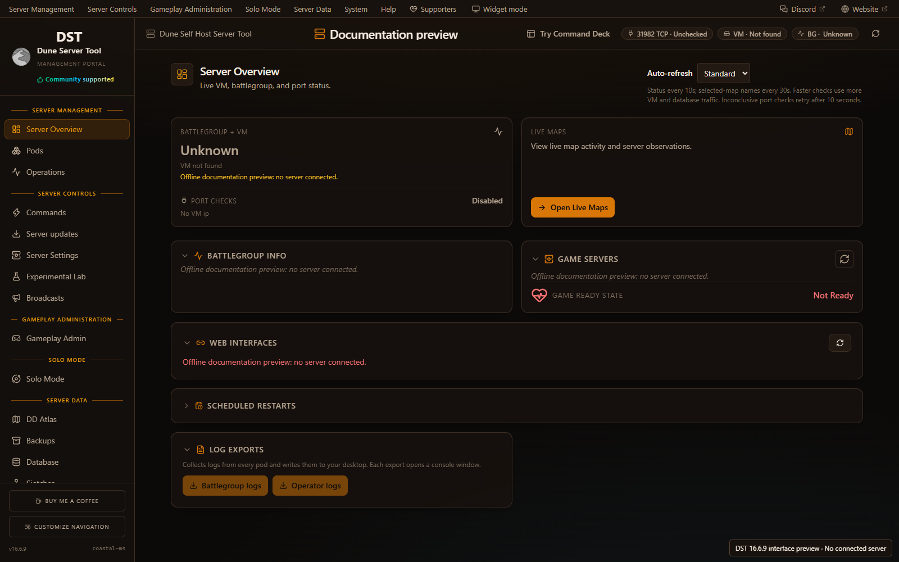

VM and battlegroup state, database and gateway health, game pods, ports, active
spice, scheduled restarts, memory warnings, interfaces, and log exports.
</details>

<details>
<summary><strong>Game Config</strong></summary>

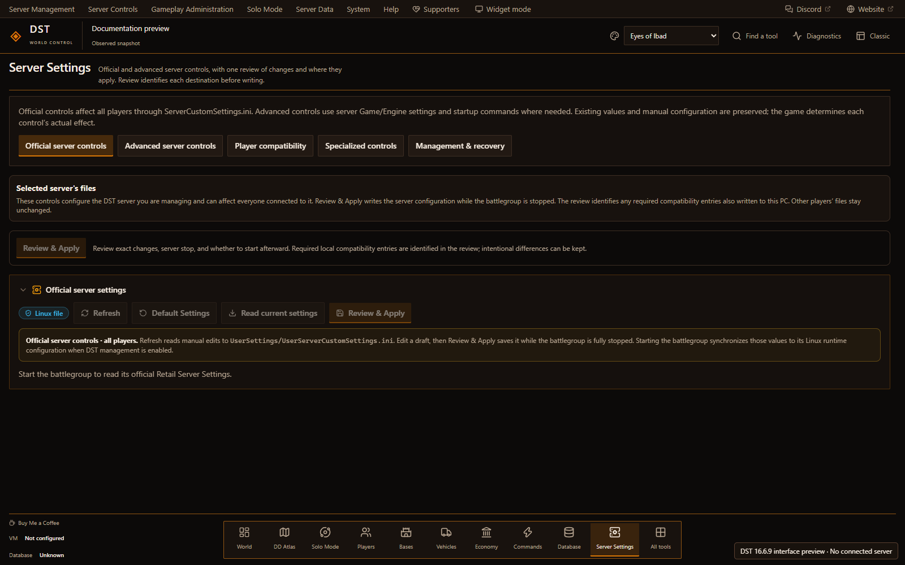

Typed server settings, Funcom defaults, backed-up edits and visible save requirements.
</details>

<details>
<summary><strong>Gameplay Admin</strong></summary>

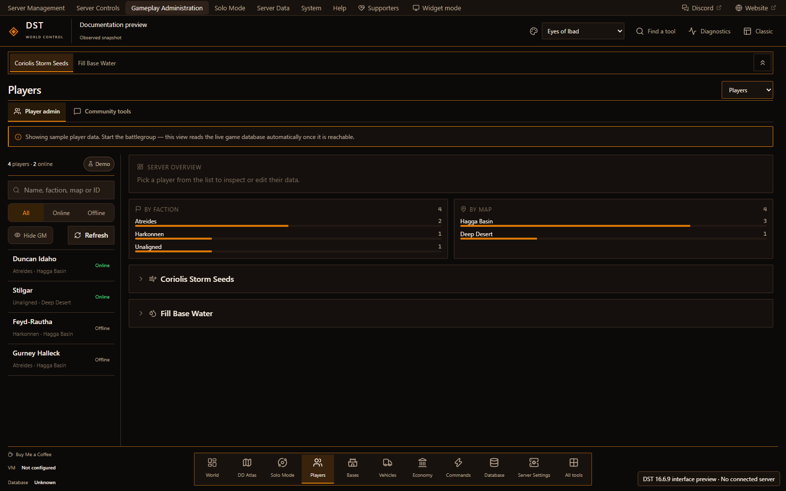

Players, Market, Market Bot, Bases, Storage, Blueprints, Landsraad Houses,
packages, vehicle kits, cosmetics, progression, teleports, and guarded writes.
Teleport tracing is diagnostic; it does not fix game-side teleport execution.
</details>

<details>
<summary><strong>Bases → Blueprints</strong></summary>

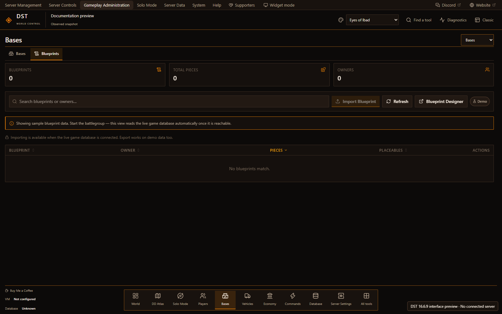

A dedicated Blueprints tab beside base management and storage inventory.
The capture contains no player buildings or imported designs.
</details>

<details>
<summary><strong>Solo Mode</strong></summary>

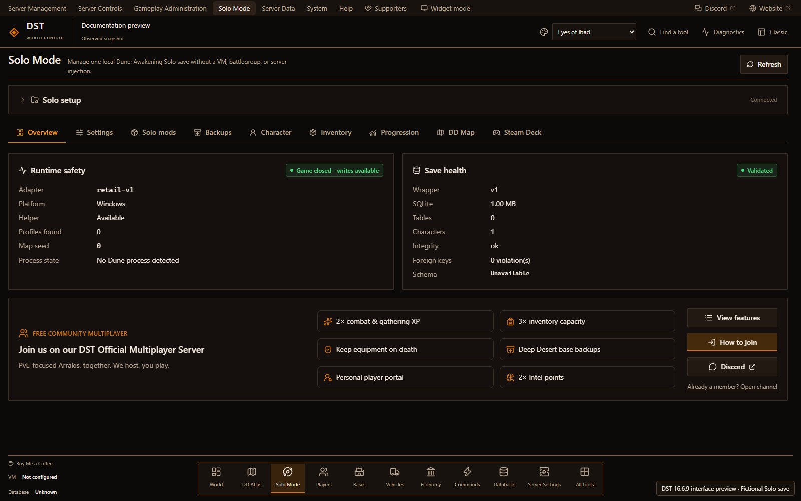

Validated local-save settings, backups, character and inventory tools,
currencies, fillables, cosmetics, packages, augments, and progression.
The current adapter targets the supported Retail Solo save format. Other or older save formats may not be compatible.
</details>

<details>
<summary><strong>DD Atlas (static)</strong></summary>

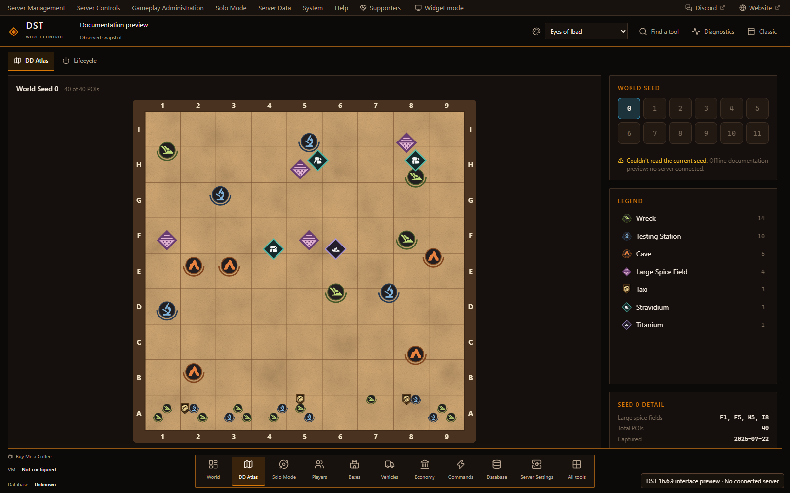

Static POI reference maps for all 12 Coriolis seeds with legend filters,
confidence notes, farm-seed selection, and running-map seed detection when
server data is available. This is not a live map.
</details>

<details>
<summary><strong>Commands</strong></summary>

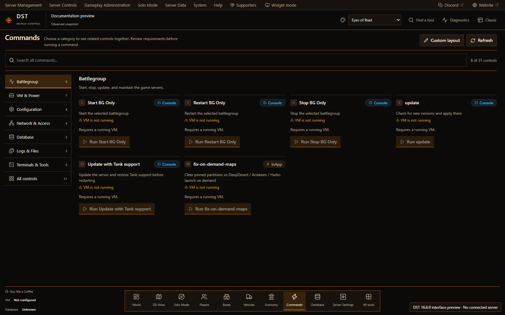

Battlegroup, VM & Power, Configuration, Network & Access, Database, Logs &
Files, and Terminals & Tools. Requirements remain visible before an action.
</details>

<details>
<summary><strong>Database</strong></summary>

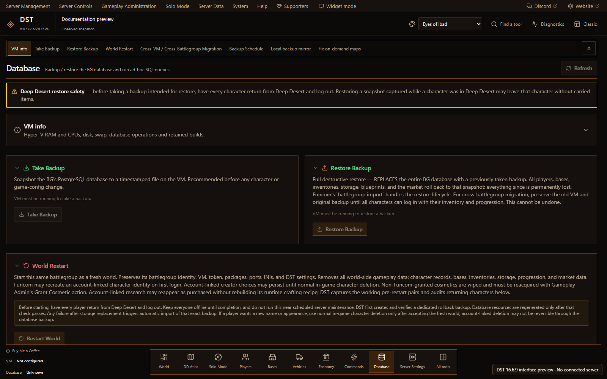

Backup, restore, import, local mirror, scheduling, SQL, migration tools, and
guarded World Restart testing.
</details>

<details>
<summary><strong>Settings</strong></summary>

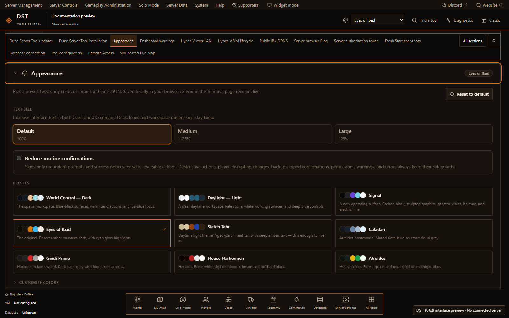

Updates, installation, themes, warnings, Remote Device Access, Browser Portal
accounts, Hyper-V over LAN, Hyper-V VM lifecycle, Public IP/DDNS, browser ping,
and host-local preferences.
</details>

<details>
<summary><strong>Browser Portal</strong></summary>

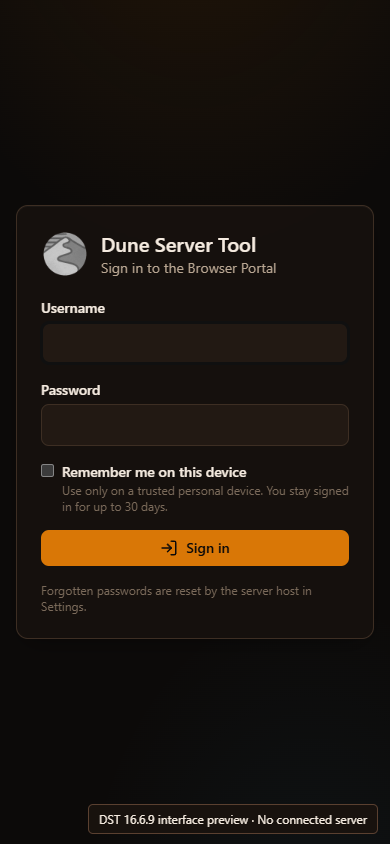

Responsive remote access with host-created accounts over Tailscale Funnel. Native mobile apps and legacy Cloudflare remote access are retired. The screenshot is the offline sign-in screen.

</details>

## Remote access and Player Portal

The Browser Portal works on phones, tablets and PCs through **Tailscale Funnel**, using host-created accounts. Native mobile apps and legacy Cloudflare remote tunnels are retired.

Hosts can create a **Player** account and link it to a game character. Player-only logins open a focused portal for that character, with maps and permitted character tools. They cannot manage other characters or run server commands. Changing an account's role or character link signs out its existing sessions.

Local setup, credentials, SSH, PowerShell and other host-only controls remain on the DST computer. Account roles determine the tools available remotely.

## Live Maps

**Existing Live Map users must switch to the VM-hosted process introduced in v16.6.0.**

The server owner opens **Settings → VM-hosted Live Map → Set up VM-hosted map** in the local DST interface. DST installs the helper automatically inside the existing VM. Remote players continue using their DST portal login; they do not install a separate helper.

Administrators open **DD Atlas → Live state**. Player-only users open **Map → Live map**. Each portal account saves its own layer selections, and collection combines requests from active viewers.

Read the [pinned Live Map FAQ](https://discord.com/channels/1517599283757453333/1563797818626547725) for migration steps, resource guidance and common questions.

## Backups and action requirements

- Database and save changes use scoped writes, backups, verification and recovery paths.
- Solo save changes require Dune to be closed. DST retains the current save and rolls back if verification fails.
- Character tools show when the player must be offline. Storage changes can require a battlegroup or map restart; follow the displayed editing requirement.
- Destructive actions require confirmation. Experimental controls are identified separately.
- The local portal uses a per-launch token. Secrets are excluded from diagnostics and repository files.

## Help and updates

| Looking for | Go to |
| --- | --- |
| Setup and installation | [Install guide](https://duneservertool.com/install) |
| Questions and community help | [DST Discord](https://discord.gg/tj2x7cywSC) |
| Bug reports | [Open an issue](https://github.com/coastal-ms/DST-DuneServerTool/issues/new/choose) |
| Stable and test downloads | [GitHub Releases](https://github.com/coastal-ms/DST-DuneServerTool/releases) |
| Active test guidance | [Testing page](https://duneservertool.com/testing) |
| Release history | [Changelog](CHANGELOG.md) |

For a bug report, use **Help → Create Diagnostics Package** and attach the generated ZIP. Keep passwords and raw credentials out of public posts.

<details>
<summary><strong>Default installation and data paths</strong></summary>

| Purpose | Path |
| --- | --- |
| Installed app | `C:\Program Files\Dune Server\` |
| Config and state | `%APPDATA%\DuneServer\` |
| Runtime logs and URL | `%LOCALAPPDATA%\DuneServer\` |
| Default VM key | `%LOCALAPPDATA%\DuneAwakeningServer\sshKey` |

</details>

## Build from source

<details>
<summary><strong>Build requirements and commands</strong></summary>

Requires PowerShell 7, Node.js, .NET SDK and Inno Setup 6.

```powershell
pwsh app/installer/Build-Installer.ps1
```

Installer output: `app/installer/output/DuneServerSetup.exe`.

To build and check the WebUI:

```powershell
cd webui
npm ci
npm run build
npm test
```

Read the [contribution guidelines](CONTRIBUTING.md) to get involved.

</details>

## License

[Apache License 2.0](LICENSE). Redistributions must preserve [NOTICE](NOTICE) and credit Coastal as the original author.
